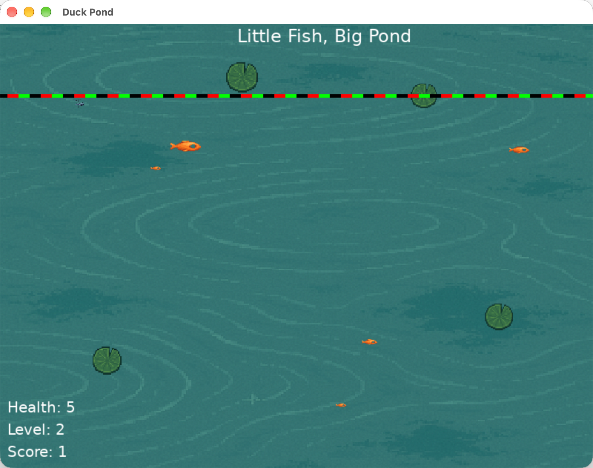

# Little Fish, Big Pond

A small top-down "big fish eats little fish" game in C++17 and SDL3, made for the CS 5850 (Building Game Engines) final project at Northeastern University, Summer 2026.

**This is not an engine written for this project.** The game was made by extending the course's **Class-070 engine**, a C++/SDL3 ECS engine with rendering, collision, input, HUD, Lua scripting, debug tooling, and a test suite. The starting point was my Class-070 directory from the course monorepo: the instructor's starter and reference code, plus my solutions to the Class-000 to Class-070 exercises. This project adds three components and three gameplay systems, replaces keyboard movement with mouse steering, and wires everything into the loader and main loop. The [Ownership](#ownership) section lists exactly what was reused, modified, and added.

| Playing (Level 2) | Win state |
|---|---|
|  |  |

The dashed line and the "Duck Pond" window title are known issues; see [Known limitations](#known-limitations).

## Gameplay

You steer a Level 1 fish around a pond.

- Touch a fish of your level or lower and you eat it for +1 score.
- Touch a higher-level fish and you lose 1 HP. A 1-second cooldown stops one long overlap from draining all your health.
- You start with 5 HP and lose when HP reaches 0.
- Every 2 points you level up and your score resets. Reaching Level 3 wins the game. The thresholds are read from `GameData.json` (`game_rules.level_thresholds: [2, 2]`).
- When you win or lose, the simulation freezes. There is no restart, so the game must be relaunched to play again.

The scene has 4 Level 1 fish, 2 Level 2 fish, and 1 Level 3 fish. NPC fish are static and do not respawn (see [Known limitations](#known-limitations)).

## Controls

Move the mouse. The fish swims toward the cursor at one of three speeds based on distance: fast beyond half the window height, normal between 80 px and half the window height, and slow within 80 px.

## Build and run

Requirements:
- CMake 3.20–4.0
- A C++17 compiler
- Python 3
- SDL3, SDL3_image, and SDL3_ttf installed where CMake's `find_package` can find them. Catch2 and the other remaining dependencies are fetched by CMake.

```bash
python compileGame.py   # configure and build
python runGame.py       # build and run
python run.py           # course command menu (build, run, tests)

# all tests, from CPP/
cmake -B build -S . && cmake --build build
ctest --test-dir build --output-on-failure
```

Tested on: macOS 27.2.1, MacBook Air (Apple M4).

On a fresh clone of the submitted version, all 8 CTest targets pass: 6 engine and 2 game targets, each a Catch2 executable containing multiple test cases. All of these tests come from the Class-070 baseline. No tests were written for the three new gameplay systems.

## Ownership

The split below comes from the diff between the baseline commit (the first commit containing code) and the `final` submission tag in the original private course repository. The baseline commit is Class-070 plus the setup changes listed under [Changes already in the baseline](#changes-already-in-the-baseline).

### Reused from the Class-070 baseline, not changed for this project

This code combines the instructor's starter and reference code with my earlier exercise work. This repository does not separate the two. The exceptions are the items in the next table.

| Area | Contents |
|---|---|
| ECS core | `EntityManager`, `ComponentStorage` design, `Blackboard`, deferred destruction |
| Engine systems | `InputSystem`, `MovementSystem`, `RenderSystem`, `CollisionSystem` (brute-force AABB), `WrapSystem`, `HUDSystem`, `DebugHUDSystem`, `CameraSystem`, `RotationSystem`, `LifetimeSystem`, `ScriptSystem`, screenshot system, and spatial-partitioning strategies |
| Infrastructure | `gamedata_loader` (apart from the additions listed below), `resource_manager`, `timer`, `lua_manager`, `lua_bindings`, JSON debug serializer, game-side CLI parser and debug state |
| Tests | All engine and game unit and property tests |
| Tooling | CMake files and Python build/run/test scripts |
| Assets | All images in `assets/images/` (frog.png is bundled but unused); DejaVu font |

### Changes already in the baseline

These were made while setting up the baseline, before its first commit. ChatGPT generated or suggested the code for each item (see [AI assistance](#ai-assistance)).

| File | Change |
|---|---|
| `engine/ecs/components.hpp`, `engine/gamedata_loader.cpp`, `engine/ecs/systems/hud_system.cpp` | Optional `Text::blackboard_key`: HUD text shows a Blackboard string when the key is set, otherwise its static `content`. The game's score, level, and health displays use this. |
| `engine/ecs/blackboard.hpp` | Exception messages for missing keys and type mismatches, matching the existing test expectations |
| `CPP/CMakeLists.txt` | Lua source fetching via `FetchContent_GetProperties` / `FetchContent_Populate`, with the `CMP0169` policy setting |
| `engine/lua_bindings.cpp` | `engine.get_entity_count()` Lua binding, from the Class-070 exercises. Unused by this game. |

### Modified for this project

| File | Change |
|---|---|
| `engine/ecs/systems/player_control_system.*` | Rewrote keyboard movement as mouse-directed steering with three distance-based speed tiers. The system now finds the `Player` component and reads the mouse position from the blackboard. |
| `engine/ecs/components.hpp`, `engine/ecs/component_storage.*` | Declared and registered the three new components (storage, accessors, explicit template instantiations). |
| `engine/gamedata_loader.cpp` | Added parsing for `player`, `fish_level`, `health`, and `game_rules.level_thresholds`. |
| `game/main.cpp` | Registered the three new systems in the update order and in the debug/trace system list; skips the simulation once the game is won or lost. |
| `assets/GameData.json` | New scene: player, NPC fish by level, lily pads, HUD bindings for score, level, and health. |

`PlayerControlSystem` lives under `engine/` but now depends on game-specific components. It belongs in `game/`. This is noted in the postmortem as engine/game boundary debt.

### New

| File | Purpose |
|---|---|
| `Player` component | Tag marking the player-controlled fish |
| `FishLevel` component | Fish level used for eat/damage decisions (player and NPCs) |
| `Health` component | HP plus damage cooldown timer |
| `game/predator_prey_resolution_syste.cpp/.hpp` | Reads the player's collisions; eats same-or-lower-level fish (score +1), or applies 1 damage from higher-level fish if the cooldown has expired |
| `game/damage_system.*` | Ticks the damage cooldown every frame and sets the lose state at 0 HP |
| `game/growth_system.*` | Checks score against the data-driven level thresholds, levels the player up, and sets the win state at the max level |

### Planned in the design document but not implemented

`submission/design.md` is the July 2026 plan. These items from it were not built:

| Planned item | Status |
|---|---|
| Two stages and stage transitions (`StageComponent`, `StageSystem`) | Cut. Level growth and a win at max level were implemented instead. |
| Dragonfly shield (`ShieldComponent`, `ShieldSystem`, `CollectibleComponent`) | Cut. A dragonfly sprite is in the scene but has no gameplay effect. |
| Frog enemy | Cut. Not in the scene. |
| NPC spawning/respawning (`SpawnSystem`) | Cut |
| Lua-driven NPC movement | Cut. NPCs reference `scripts/wander.lua`, which is empty, so NPCs do not move. |
| Explicit render layering and lily-pad cover (`LilyPadComponent`, `PlayerMarkerComponent`) | Cut. Lily pads are plain images, drawn in entity order. |
| Collision layer/mask filtering | Cut. The baseline's layer/mask fields exist, but every entity uses the same value. |
| Separate `DamageCooldownComponent` and `PendingDamage` step | Partial. Cooldown is stored inside `Health`, and health is reduced directly in `PredatorPreyResolutionSystem`. |
| Speed tiers configured in `GameData.json` | Partial. Tiers work, but the multipliers and the 80 px threshold are hard-coded. |
| `ScoreComponent` | Not used. Score is stored in the blackboard (`game.score`). |
| Player grows visually on level-up | Not implemented |

`submission/postmortem.md` explains these cuts. It is kept exactly as submitted. Where it says "my Class-070 engine", it means the Class-070 reference implementation described above.

### AI assistance

ChatGPT generated or suggested the code for the items in [Changes already in the baseline](#changes-already-in-the-baseline). The three new components, three new systems, and the `PlayerControlSystem` rewrite were written without AI-generated code. This disclosure covers the changes made for this project and the baseline items listed above. It makes no claim about the rest of the baseline.

## Known limitations

- NPC fish are static and never respawn, so each run is short and the level thresholds are deliberately low.
- No restart after winning or losing.
- The player uses the same sprite as the NPC fish and has no marker, so it can be hard to pick out.
- The JSON loader aborts on a mistyped key instead of reporting it; see the postmortem for the `type_error.302` debugging story.
- Blackboard values are type-sensitive: reading a key as the wrong type silently returns the default value.
- No automated tests cover the new gameplay systems.

Known code issues, present in this repository:
- `GrowthSystem` prints debug output to stdout every frame.
- The file name `predator_prey_resolution_syste.cpp` is misspelled.
- The `Health` struct defaults `hp` to 100. The scene data overrides this to 5.
- The window title is hard-coded as "Duck Pond" in `main.cpp`. The `window.title` value in `GameData.json` is not used.
- The world rectangle in `GameData.json` (y from −400 to 200) does not match the 800×600 view, so the engine's world-border debug line is drawn across the upper part of the screen.
- The win and lose messages replace the Health line in the HUD.

## License and credits

- Course material, including the Class-070 reference engine, build scripts, and starter code: MIT License, © 2026 Juancho Buchanan. See `LICENSE`.
- Third-party components keep their own licenses: SDL3 (zlib), Lua (MIT), Catch2 (BSL-1.0), nlohmann/json (MIT), DejaVu font (Bitstream Vera / Arev, see `assets/fonts/LICENSE-DejaVu.txt`).
- Images were generated for the course with `openai/gpt-5-image`; prompts are recorded in `assets/asset_manifest.json`.
- Code written for this project: MIT License, © 2026 Yufan Wang.
